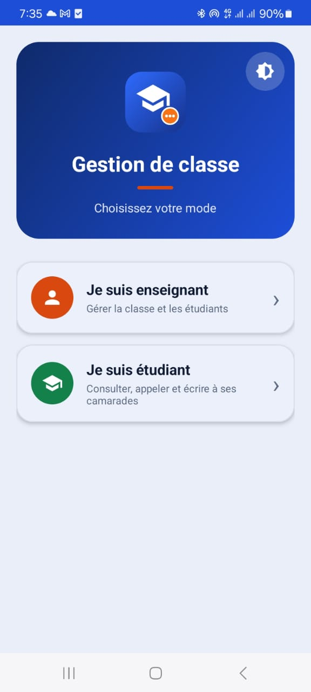
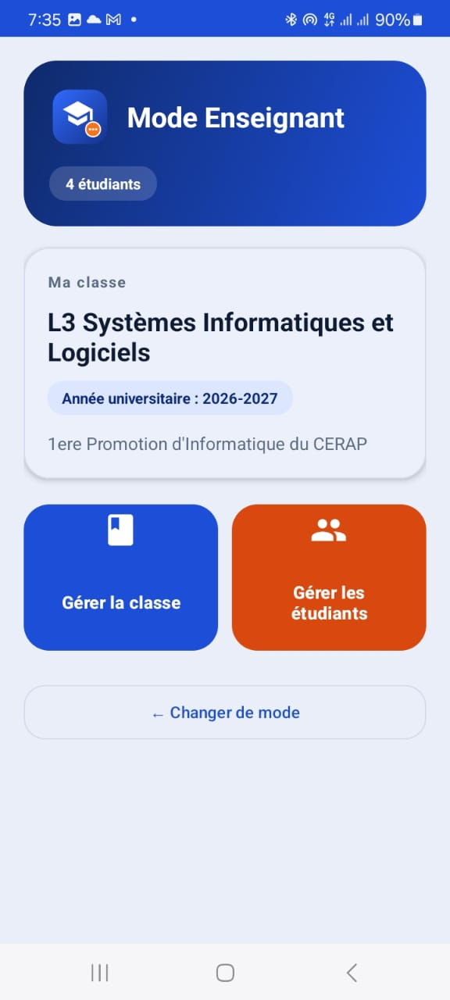
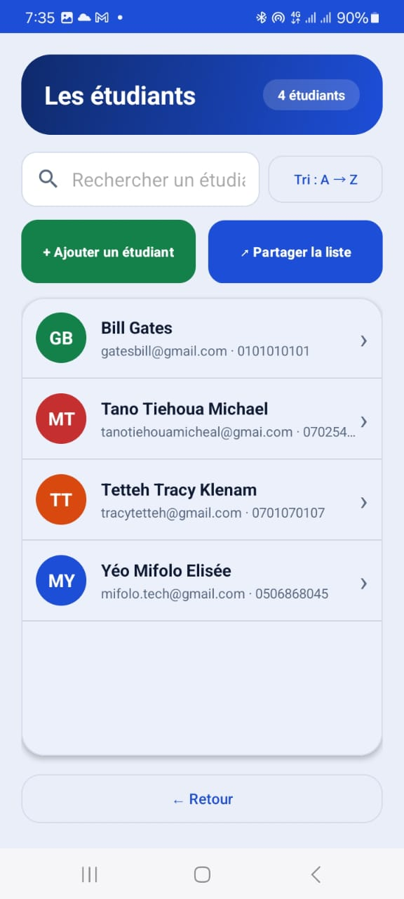
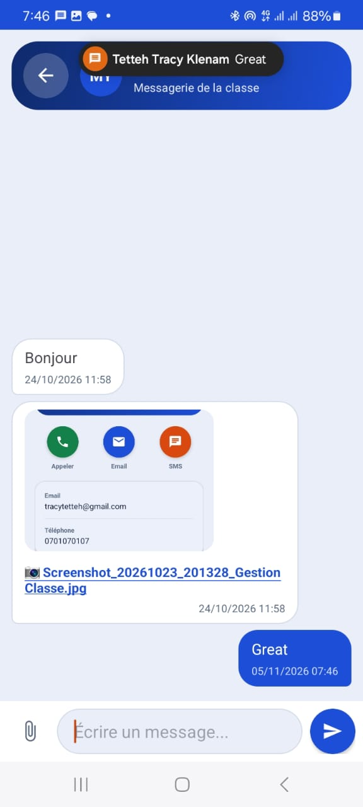

🇬🇧 [English](README.md) | 🇫🇷 Français

# GestionClasse

Application Android native (Java + XML + Room) de gestion de classe : étudiants, appels téléphoniques et messagerie locale avec pièces jointes. Projet final du module *Développement mobile*, L3 Systèmes d'Information et Logiciels (SIL), CERAP Abidjan.

## Sommaire
- [Fonctionnalités](#fonctionnalités)
- [Captures d'écran](#captures-décran)
- [Technologies](#technologies)
- [Architecture](#architecture)
- [Modèle de données](#modèle-de-données)
- [Structure du projet](#structure-du-projet)
- [Installation](#installation)
- [Utilisation](#utilisation)
- [Permissions](#permissions)
- [Tests réalisés](#tests-réalisés)
- [Limites et perspectives](#limites-et-perspectives)
- [Auteur](#auteur)

## Fonctionnalités

**Exigées par le sujet**
- Deux modes au lancement : **Enseignant** et **Étudiant**.
- Création et modification de la classe (une seule classe, en local).
- CRUD des étudiants : ajout, modification, suppression, liste, détail.
- Bouton d'appel via `ACTION_DIAL` (ouvre le composeur, ne lance jamais l'appel).
- Choix du profil de l'étudiant, puis du destinataire (l'expéditeur est exclu).
- Messagerie locale : messages envoyés à droite, reçus à gauche, triés par date.
- Pièce jointe par message : photo, vidéo ou document.
- Notifications locales à la réception d'un message.
- Stockage local persistant avec Room.

**Fonctionnalités ajoutées**
- Recherche d'étudiants pendant la frappe, tri alphabétique tenant compte des accents.
- Validation des saisies avec messages d'erreur clairs.
- Partage de la liste, e-mail ou SMS à un étudiant.
- Avatars colorés avec initiales.
- Aperçu des images dans la conversation (cache, chargement asynchrone).
- Thème clair / sombre / système, mémorisé entre les lancements.
- Écran d'accueil animé, design Material 3 arrondi, animations de transition.
- Compteur d'étudiants avec gestion du pluriel.

## Captures d'écran
Place tes captures dans `docs/screenshots/`.

| Choix du rôle | Tableau de bord | Liste des étudiants | Conversation |
|---|---|---|---|
|  |  |  |  |

## Technologies
| Domaine | Choix |
|---|---|
| Langage | Java |
| Interface | Layouts XML, View Binding, Material 3 (DayNight) |
| Persistance | Room (SQLite), LiveData |
| Architecture | En couches : UI → ViewModel → Repository → Room |
| Listes | RecyclerView à deux types de vues (envoyé / reçu) |
| SDK minimum | 24 (Android 7.0) |
| Package | `ci.example.gestionclasse` |

## Architecture
```
Activities / Adapters   (écrans, affichage seulement)
        │  ▲
        ▼  │ LiveData
     ViewModel          (état de l'écran, survit à la rotation)
        │  ▲
        ▼  │
     Repository         (point d'entrée unique, écritures en arrière-plan)
        │  ▲
        ▼  │
   Room (DAO + Entités) → SQLite
```
Les classes utilitaires (`Validateur`, `Avatar`, `PiecesJointes`, `ApercuImage`, `NotificationHelper`, `ThemeHelper`, `Constantes`) sont utilisées par les couches du dessus.

## Modèle de données
Trois tables : `classe`, `etudiant`, `message`.
- Une classe a plusieurs étudiants.
- Un étudiant est expéditeur de plusieurs messages et destinataire de plusieurs messages.
- Supprimer un étudiant supprime ses messages (`ON DELETE CASCADE`).

## Structure du projet
```
app/src/main/java/ci/example/gestionclasse/
├── data/         entités, DAO, AppDatabase, GestionRepository
├── viewmodel/    ClasseViewModel, EtudiantViewModel, MessageViewModel
├── ui/           Splash, Role, Accueil, Classe, ListeEtudiants,
│                 FormulaireEtudiant, DetailEtudiant, Conversation + adapters
├── util/         Constantes, Validateur, Avatar, PiecesJointes, ApercuImage,
│                 NotificationHelper, ThemeHelper
└── GestionClasseApp.java
```

## Installation
**Prérequis :** Android Studio récent, JDK 17+ (le JBR fourni convient), un téléphone ou émulateur Android 7.0+.

```bash
git clone https://github.com/mifolotech/classroom-manager-android.git
```
1. Ouvrir le dossier dans Android Studio et attendre la synchronisation Gradle.
2. Choisir un appareil (téléphone USB avec débogage activé, ou émulateur API 34/35).
3. Cliquer sur **Run ▶**.

**Générer un APK :** *Build → Build Bundle(s) / APK(s) → Build APK(s)*.

## Utilisation
1. Choisir **Enseignant** ou **Étudiant** sur le premier écran.
2. *Enseignant :* créer la classe, puis ajouter et gérer les étudiants.
3. *Étudiant :* choisir son profil, choisir un camarade, l'appeler ou lui écrire.
4. La messagerie est simulée sur un seul appareil en changeant de profil.
5. Le bouton de thème (en haut à droite du premier écran) bascule clair / sombre / système.

## Permissions
- `POST_NOTIFICATIONS` (Android 13+) : notifications locales, demandée à l'exécution.
- Les pièces jointes passent par le sélecteur de documents du système : aucune permission de stockage.
- L'appel ouvre seulement le composeur : aucune permission d'appel.

## Tests réalisés
Tests manuels sur un vrai téléphone Android : CRUD, validation, recherche, appel, messagerie avec chaque type de pièce jointe, notifications, rotation, mode sombre et persistance des données après fermeture.

## Limites et perspectives
- Une classe, un appareil ; ni serveur ni comptes en ligne (par conception du projet).
- Interface en français uniquement (traduction anglaise `values-en` envisagée).
- Pistes : tests automatisés, export CSV, plusieurs classes.

## Auteur
**Yéo Mifolo Elisée**, L3 SIL, CERAP Abidjan. GitHub : [@mifolotech](https://github.com/mifolotech)
Enseignante : Dr JOHNSON Grâce Yénin Edwige épouse KOUASSI.

*Projet académique. Ajoute une licence de ton choix avant toute réutilisation par d'autres.*
