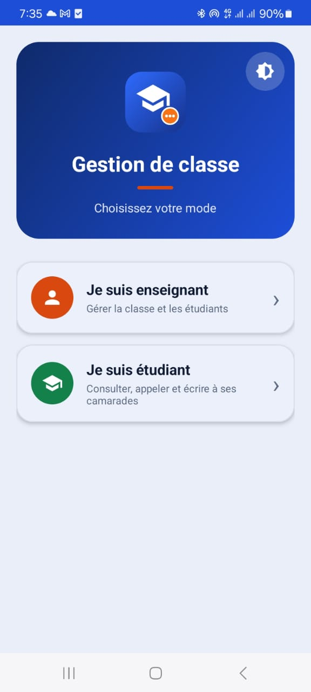
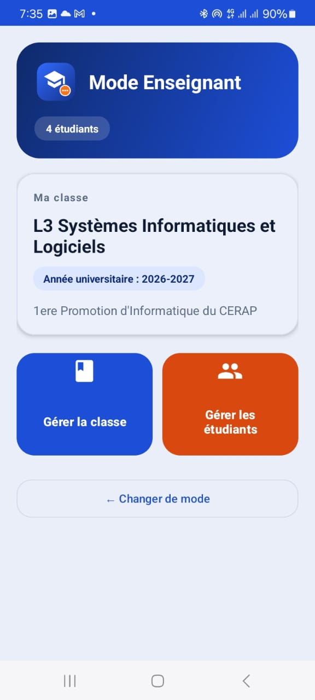
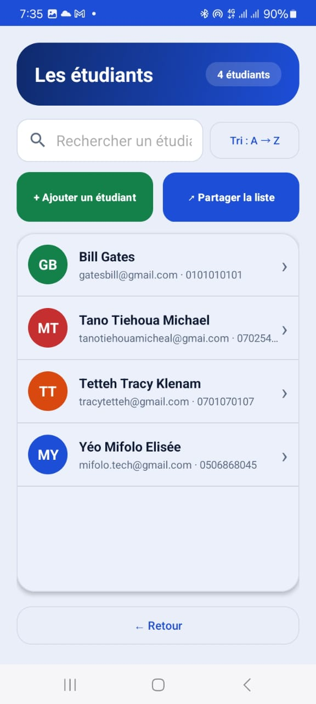
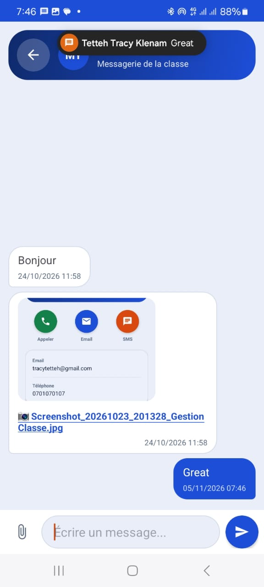

🇬🇧 English | 🇫🇷 [Français](README.fr.md)

# GestionClasse

A native Android app (Java + XML + Room) to manage a class: students, phone calls, and local messaging with attachments. Final project of the *Mobile Development* course, L3 Software & Information Systems (SIL), CERAP Abidjan.

> **Note:** the app's user interface is in **French** (target audience: francophone classrooms in Côte d'Ivoire). The documentation is provided in English and French.

## Table of contents
- [Features](#features)
- [Screenshots](#screenshots)
- [Tech stack](#tech-stack)
- [Architecture](#architecture)
- [Data model](#data-model)
- [Project structure](#project-structure)
- [Getting started](#getting-started)
- [Usage](#usage)
- [Permissions](#permissions)
- [Tests performed](#tests-performed)
- [Limitations and roadmap](#limitations-and-roadmap)
- [Author](#author)

## Features

**Required by the course**
- Two modes at launch: **Teacher** and **Student**.
- Class creation and editing (single class, local only).
- Student CRUD: add, edit, delete, list, detail view.
- Phone call button using `ACTION_DIAL` (opens the dialer; never places the call itself).
- Student profile selection, then recipient selection (the sender is excluded).
- Local messaging: sent messages on the right, received on the left, sorted by date.
- Attachments per message: photo, video or document.
- Local notifications when a message is received.
- Persistent local storage with Room.

**Added features**
- Search students by name as you type, with accent-aware alphabetical sorting.
- Input validation with clear error messages.
- Share the class list, send email or SMS to a student.
- Colored avatars with initials.
- Image preview in the conversation (cached, loaded asynchronously).
- Dark / light / system theme, saved between launches.
- Splash screen, rounded Material 3 design, screen transition animations.
- Student counter with plural handling.

## Screenshots
Add your screenshots in `docs/screenshots/`.

| Role selection | Dashboard | Student list | Conversation |
|---|---|---|---|
|  |  |  |  |

## Tech stack
| Area | Choice |
|---|---|
| Language | Java |
| UI | XML layouts, View Binding, Material 3 (DayNight) |
| Persistence | Room (SQLite), LiveData |
| Architecture | Layered: UI → ViewModel → Repository → Room |
| Lists | RecyclerView with two view types (sent / received) |
| Min SDK | 24 (Android 7.0) |
| Package | `ci.example.gestionclasse` |

## Architecture
```
Activities / Adapters   (screens, display only)
        │  ▲
        ▼  │ LiveData
     ViewModel          (screen state, survives rotation)
        │  ▲
        ▼  │
     Repository         (single data entry point, background writes)
        │  ▲
        ▼  │
   Room (DAO + Entities) → SQLite
```
Utility classes (`Validateur`, `Avatar`, `PiecesJointes`, `ApercuImage`, `NotificationHelper`, `ThemeHelper`, `Constantes`) are used by the layers above.

## Data model
Three tables: `classe`, `etudiant`, `message`.
- One class has many students.
- A student is the sender of many messages and the recipient of many messages.
- Deleting a student cascades to their messages (`ON DELETE CASCADE`).

## Project structure
```
app/src/main/java/ci/example/gestionclasse/
├── data/         entities, DAOs, AppDatabase, GestionRepository
├── viewmodel/    ClasseViewModel, EtudiantViewModel, MessageViewModel
├── ui/           Splash, Role, Accueil, Classe, ListeEtudiants,
│                 FormulaireEtudiant, DetailEtudiant, Conversation + adapters
├── util/         Constantes, Validateur, Avatar, PiecesJointes, ApercuImage,
│                 NotificationHelper, ThemeHelper
└── GestionClasseApp.java
```

## Getting started
**Requirements:** Android Studio (recent version), JDK 17+ (the bundled JBR works), an Android 7.0+ device or emulator.

```bash
git clone https://github.com/mifolotech/classroom-manager-android.git
```
1. Open the folder in Android Studio and wait for the Gradle sync.
2. Select a device (USB phone with debugging enabled, or an emulator with API 34/35).
3. Click **Run ▶**.

**Build an APK:** *Build → Build Bundle(s) / APK(s) → Build APK(s)*.

## Usage
1. Choose **Teacher** or **Student** on the first screen.
2. *Teacher:* create the class, then add and manage students.
3. *Student:* pick your profile, pick a classmate, call or write to them.
4. Messaging is simulated on one device by switching profiles.
5. The theme button (top right of the first screen) switches light / dark / system.

## Permissions
- `POST_NOTIFICATIONS` (Android 13+): local notifications. Requested at runtime.
- Attachments use the system document picker; no storage permission is needed.
- Calls only open the dialer, so no call permission is required.

## Tests performed
Tested manually on a real Android phone: CRUD, validation, search, call, messaging with each attachment type, notifications, rotation, dark mode and data persistence after closing the app.

## Limitations and roadmap
- One class, one device; no server, no online accounts (by design of the project).
- UI available in French only (an English `values-en` translation is planned).
- Possible next steps: automated tests, export to CSV, multi-class support.

## Author
**Yéo Mifolo Elisée**, L3 SIL, CERAP Abidjan. GitHub: [@mifolotech](https://github.com/mifolotech)
Course instructor: Dr JOHNSON Grâce Yénin Edwige épouse KOUASSI.

*Academic project. Add a license of your choice before reuse by others.*
